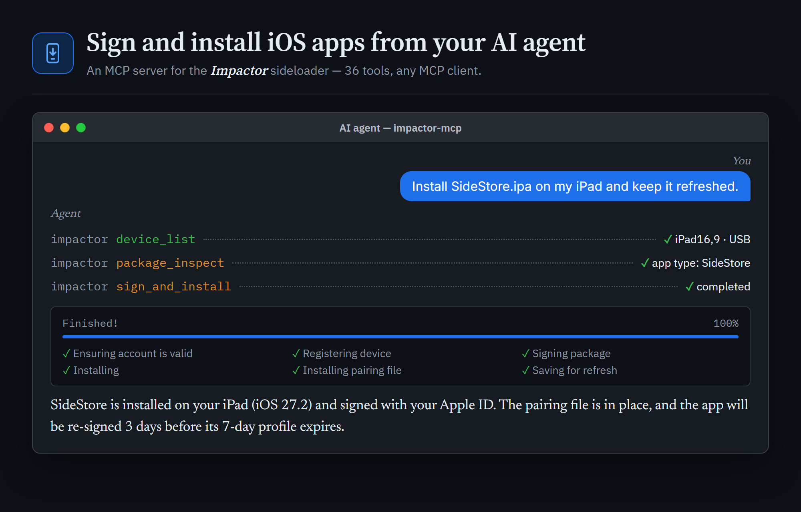
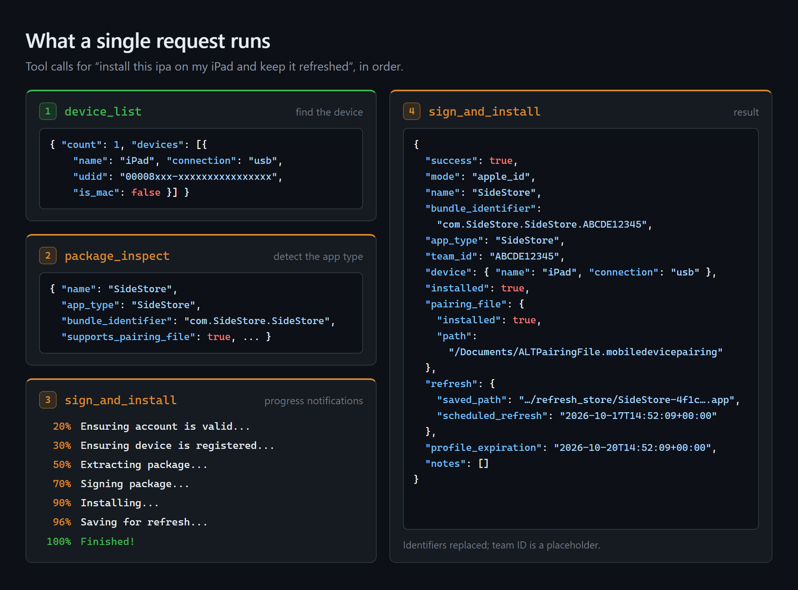
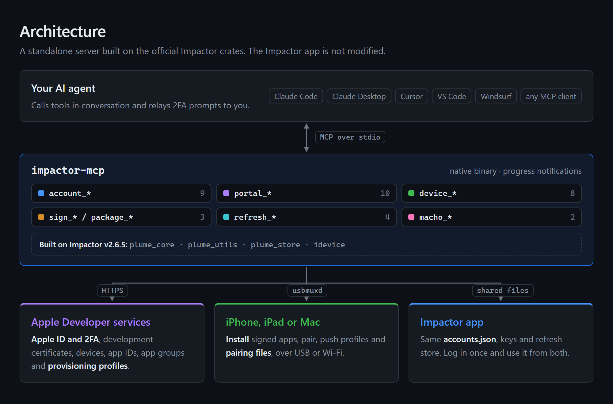
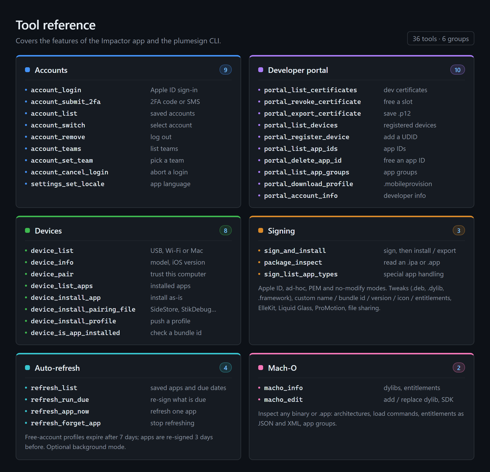

# Impactor MCP server



An [MCP](https://modelcontextprotocol.io) server that lets any AI agent or MCP client (Claude, Cursor, VS Code Copilot, Windsurf, ...) do everything the
[Impactor](https://github.com/claration/Impactor) sideloader does: sign in with an Apple ID (including
2FA), manage developer-portal certificates/devices/app IDs, sign and install `.ipa` files with
tweaks and customizations, install pairing files, and keep apps refreshed before they expire.

It is a **standalone add-on**. It builds against the official Impactor release (`v2.6.5`, fetched by
Cargo) and shares Impactor's data directory, so it works next to the stock Impactor app — you never
need a modified build of the app. Accounts you log into in the app show up here and vice versa.

> **Made by Claude.** This MCP server, its installers and this README were written by
> [Claude](https://claude.ai) (Anthropic's AI model) via Claude Code. It is an unofficial
> companion project, not affiliated with or endorsed by the Impactor authors.

## What it does

One request from the agent becomes the same steps you would click through in the Impactor app:





## Install

One line, nothing to clone or download by hand:

**Windows** (PowerShell):

```powershell
irm https://raw.githubusercontent.com/YeetDisDude/impactor-mcp/main/install.ps1 | iex
```

**macOS / Linux**:

```sh
curl -fsSL https://raw.githubusercontent.com/YeetDisDude/impactor-mcp/main/install.sh | sh
```

The installer downloads the prebuilt binary for your platform from the latest
[release](https://github.com/YeetDisDude/impactor-mcp/releases) (no Rust needed). If there is
none for your platform, it builds from source with `cargo`, installing Rust first if needed. It
then installs the binary to `%LOCALAPPDATA%\impactor-mcp\impactor-mcp.exe` (Windows) or
`~/.local/bin/impactor-mcp`, and registers it with **Claude Code** (`claude mcp add`, user scope) and
**Claude Desktop** (`claude_desktop_config.json`, a `.bak` copy is kept). Restart Claude Desktop
afterwards. Running `install.ps1` / `install.sh` from a local clone also downloads the prebuilt
binary; it only compiles (that clone) with `-FromSource` / `--from-source` or when no prebuilt
binary exists for your platform.

Passing options:

```powershell
& ([scriptblock]::Create((irm https://raw.githubusercontent.com/YeetDisDude/impactor-mcp/main/install.ps1))) -AutoRefresh
```

```sh
curl -fsSL https://raw.githubusercontent.com/YeetDisDude/impactor-mcp/main/install.sh | sh -s -- --auto-refresh
```

| Option (ps1 / sh) | Effect |
| --- | --- |
| `-NoClaudeCode` / `--no-claude-code` | Don't register with Claude Code |
| `-NoDesktop` / `--no-desktop` | Don't touch the Claude Desktop config |
| `-AutoRefresh` / `--auto-refresh` | Refresh saved apps in the background (see below) |
| `-FromSource` / `--from-source` | Build with cargo instead of downloading a prebuilt binary |
| `-Uninstall` / `--uninstall` | Remove the binary and both registrations |

### Requirements

- **Windows:** iTunes or *Apple Devices* (Microsoft Store) for device access.
- **Linux:** `usbmuxd`.
- Only when building from source: the MSVC C++ build tools on Windows
  (`winget install Microsoft.VisualStudio.2022.BuildTools`), Xcode command line tools on macOS.

### Manual setup

```sh
cargo install --locked --git https://github.com/YeetDisDude/impactor-mcp impactor-mcp
claude mcp add --scope user impactor -- ~/.cargo/bin/impactor-mcp
```

Any other MCP client (Cursor, VS Code, Windsurf, Cline, ...) uses the same stdio entry in its MCP config:

```json
{ "mcpServers": { "impactor": { "command": "/absolute/path/to/impactor-mcp", "args": [] } } }
```

## Tools



| Area | Tools |
| --- | --- |
| Accounts | `account_list`, `account_login`, `account_submit_2fa`, `account_cancel_login`, `account_switch`, `account_remove`, `account_teams`, `account_set_team`, `settings_set_locale` |
| Developer portal | `portal_account_info`, `portal_list_certificates`, `portal_revoke_certificate`, `portal_list_devices`, `portal_register_device`, `portal_list_app_ids`, `portal_delete_app_id`, `portal_list_app_groups`, `portal_download_profile`, `portal_export_certificate` |
| Devices | `device_list`, `device_info`, `device_pair`, `device_list_apps`, `device_install_app`, `device_install_pairing_file`, `device_install_profile`, `device_is_app_installed` |
| Signing | `package_inspect`, `sign_and_install`, `sign_list_app_types` |
| Mach-O | `macho_info`, `macho_edit` |
| Auto-refresh | `refresh_list`, `refresh_app_now`, `refresh_run_due`, `refresh_forget_app` |

`sign_and_install` covers the app's whole install screen: Apple ID / ad-hoc / PEM / no-modify signing,
install and/or export, custom name / bundle id / version / icon / entitlements, single profile,
tweaks (`.deb`, `.dylib`, `.framework`, `.bundle`, `.appex`), the feature toggles (minimum OS, file
sharing, iPad fullscreen, game mode, ProMotion, Liquid Glass, ElleKit), pairing-file installation and
saving for auto-refresh. Long operations report MCP progress notifications.

Example prompts:

- "Log me into Impactor with my Apple ID" (the agent will ask you for the 2FA code)
- "Sign ~/Downloads/SideStore.ipa and install it on my iPhone, and keep it refreshed"
- "Inject this tweak into the app and export the signed ipa to my desktop"

## Notes

- **Certificate resets.** Free accounts can hold only a few development certificates. When a new one
  is needed and the limit is hit, tools fail with a hint instead of revoking anything. Pass
  `allow_certificate_reset: true` only if you accept that existing SideStore/AltStore installs break.
- **Auto-refresh.** Apps installed with `refresh: true` are re-signed before their 7-day profile
  expires when you call `refresh_run_due`, or automatically every 3 minutes when the server runs
  with `IMPACTOR_MCP_AUTO_REFRESH=1`. The Impactor app has its own refresh daemon; enable auto-refresh
  in only one of them.
- **Shared data.** Both use `accounts.json` in `%APPDATA%\PlumeImpactor` (Windows) or
  `~/.config/PlumeImpactor`. The app keeps a copy in memory, so changes made here (e.g. a new login)
  may need an app restart to appear there.
- **Logs** go to stderr (stdout is the protocol channel). Set `RUST_LOG=debug` for detail.
- **Following newer Impactor releases:** bump the `tag` values in `Cargo.toml` and run
  `cargo update`.

## Releasing

Pushing a tag such as `v2.6.5` runs `.github/workflows/release.yml`. It builds Windows, macOS and
Linux binaries (x86_64 and arm64) and attaches them to the GitHub release that the installers
download from.

## Credits

Built on [Impactor](https://github.com/claration/Impactor) by claration (MIT) and
[idevice](https://github.com/jkcoxson/idevice). The MCP server itself was made by Claude.
